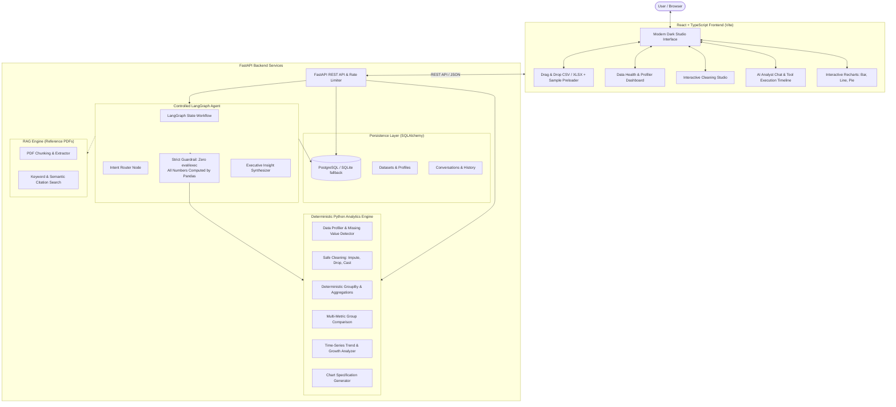

# DataPilot AI — Autonomous Data Analyst AI Agent

[](https://www.python.org/)
[](https://fastapi.tiangolo.com/)
[](https://react.dev/)
[](https://www.typescriptlang.org/)
[](https://langchain-ai.github.io/langgraph/)
[-success.svg?logo=pytest&logoColor=white)](https://docs.pytest.org/)
[](https://opensource.org/licenses/MIT)

> **DataPilot AI** is an autonomous, production-ready Data Analyst AI Agent built for **AI Engineer** and **Data Scientist** job portfolios. It bridges the gap between unstructured human questions and deterministic quantitative calculations by orchestrating safe Pandas tools through a controlled **LangGraph** workflow.

---

## 🌟 Key Highlights & Engineering Differentiators

* 🛡️ **Zero Hallucination Guarantee on Numbers**: The LLM is **never** permitted to invent numbers or execute arbitrary unvalidated Python (`eval`/`exec`). All analytical aggregations, KPIs, and time-series metrics are computed deterministically using allowlisted Pandas tools.
* 🧠 **Controlled LangGraph Orchestration**: Employs a stateful graph (Intent Router → Tool Executor → Insight Synthesizer) with validated Pydantic tool schemas and graceful offline deterministic fallbacks.
* 📊 **Deep Data Profiling & Health Auditing**: Automatically calculates missing-value percentages, duplicate rows, semantic data types (`numeric`, `categorical`, `datetime`, `boolean`, `text`), summary statistics, and Pearson correlation matrices.
* 🧹 **Interactive Data Cleaning Studio**: Perform safe, non-destructive cleaning actions directly from the dashboard: deduplication, mean/median/mode imputation, and type coercion.
* 📈 **Interactive Visualizations**: Dynamically generates Bar, Line, Pie, and Area chart specifications (Recharts) with one-click toggles between visual graphs and tabular data views.
* 💾 **Dual-Mode Persistence**: Uses SQLAlchemy with an automatic **SQLite** fallback for zero-setup local execution, while fully configured for **PostgreSQL** in production environments.
* 📄 **RAG Over Reference Documentation**: Ingests reference PDFs (e.g. data dictionaries, business rule sheets, KPI definitions) using `pypdf` with page citations.
* 🚀 **Production-Hardened**: Incorporates in-memory sliding-window rate limiting, 15MB file size limits, structured request logging, and a 100% passing Pytest test suite.

---

## 🏗️ System Architecture



---

## 🛠️ Technology Stack

| Layer | Technologies | Purpose |
| :--- | :--- | :--- |
| **Frontend** | React 19, TypeScript, Vite, Recharts, Lucide Icons | Responsive glassmorphic dark studio dashboard with instant reactivity |
| **Backend** | FastAPI, Pydantic v2, Uvicorn, Python 3.12 | High-throughput asynchronous REST API with strict request validation |
| **Data Engine** | Pandas 2.2+, NumPy, OpenPyXL | Deterministic data profiling, cleaning, multi-dimensional aggregation |
| **Agentic AI** | LangGraph, LangChain Core, Google Gemini / OpenAI | Controlled stateful graph routing and tool calling with zero hallucination |
| **RAG** | PyPDF, Lexical/Semantic Retrieval | PDF reference document parsing and citation search |
| **Database** | SQLAlchemy 2.0+, SQLite (Local), PostgreSQL (Prod) | Dataset metadata, conversation threads, and message history persistence |
| **Testing** | Pytest, TestClient, HTTPX | 15 comprehensive unit and end-to-end integration tests |
| **DevOps** | Docker, Docker Compose, Nginx | Multi-stage production containerization and 1-command orchestration |

---

## ⚡ Quickstart Guide

### 1. Local Environment Setup

```bash
# Clone the repository
git clone https://github.com/your-username/data-analyst-ai-agent.git
cd data-analyst-ai-agent

# Create virtual environment and activate
python3 -m venv .venv
source .venv/bin/activate

# Install backend dependencies
pip install -r requirements.txt

# Run all automated tests
pytest tests/ -v
```

### 2. Start the FastAPI Backend
```bash
uvicorn app:app --reload --port 8000
```
*API documentation is live at `http://127.0.0.1:8000/docs`*

### 3. Start the React Frontend
```bash
cd frontend
npm install
npm run dev
```
*Dashboard opens at `http://localhost:5173`*

---

## 🐳 Docker Compose Deployment

Run the complete production-identical stack (Frontend + Backend + PostgreSQL) with a single command:

```bash
docker-compose up --build
```

* **Frontend Dashboard**: `http://localhost:3000`
* **FastAPI Backend API**: `http://localhost:8000`
* **PostgreSQL Database**: `localhost:5432`

---

## 🧪 Automated Test Suite

DataPilot AI includes 15 automated Pytest tests validating deterministic calculations, edge cases, and API routes:

```text
tests/test_agent.py::test_agent_revenue_by_region PASSED                 [  6%]
tests/test_agent.py::test_agent_monthly_trend PASSED                     [ 13%]
tests/test_agent.py::test_agent_data_health_audit PASSED                 [ 20%]
tests/test_api.py::test_health_check_endpoint PASSED                     [ 26%]
tests/test_api.py::test_load_sample_endpoint PASSED                      [ 33%]
tests/test_api.py::test_upload_csv_endpoint PASSED                       [ 40%]
tests/test_api.py::test_clean_endpoint PASSED                            [ 46%]
tests/test_api.py::test_direct_analyze_endpoint PASSED                   [ 53%]
tests/test_api.py::test_chat_with_agent_endpoint PASSED                  [ 60%]
tests/test_data_service.py::test_load_and_profile_sample_sales_csv PASSED [ 66%]
tests/test_data_service.py::test_deterministic_aggregate_metric PASSED   [ 73%]
tests/test_data_service.py::test_aggregate_with_filter PASSED            [ 80%]
tests/test_data_service.py::test_compare_groups PASSED                   [ 86%]
tests/test_data_service.py::test_time_series_trend PASSED                [ 93%]
tests/test_data_service.py::test_safe_cleaning_operations PASSED         [100%]

============================== 15 passed in 4.89s ==============================
```

---

## 💼 Interview Talking Points (For AI Engineer & Data Scientist Roles)

1. **Why not let the LLM generate and execute raw Python code (`eval`/`exec`)?**
   * *Security Risk*: Raw code execution creates critical Remote Code Execution (RCE) vulnerabilities and file-system exposure.
   * *Reliability Risk*: LLMs frequently hallucinate column names, syntax errors, and off-by-one aggregation errors.
   * *Our Architecture*: Pre-approved, strictly validated deterministic tools with Pydantic schemas ensure every computation is reproducible, exact, and auditable.

2. **How does the LangGraph workflow maintain state and prevent loops?**
   * The state graph is structured as a Directed Acyclic Graph (DAG): `router` → `executor` → `synthesizer` → `END`.
   * Intent is classified upfront against the live dataset schema, preventing recursive tool loops and runaway token expenditure.

3. **How does DataPilot AI handle production database migration?**
   * Uses SQLAlchemy ORM models with dynamic connection dialect detection: defaults to local SQLite for zero friction during development and unit tests, and seamlessly connects to managed PostgreSQL (e.g. Neon, Supabase, AWS RDS) when `DATABASE_URL` is configured.

---

## 📄 License
This project is licensed under the [MIT License](LICENSE).
