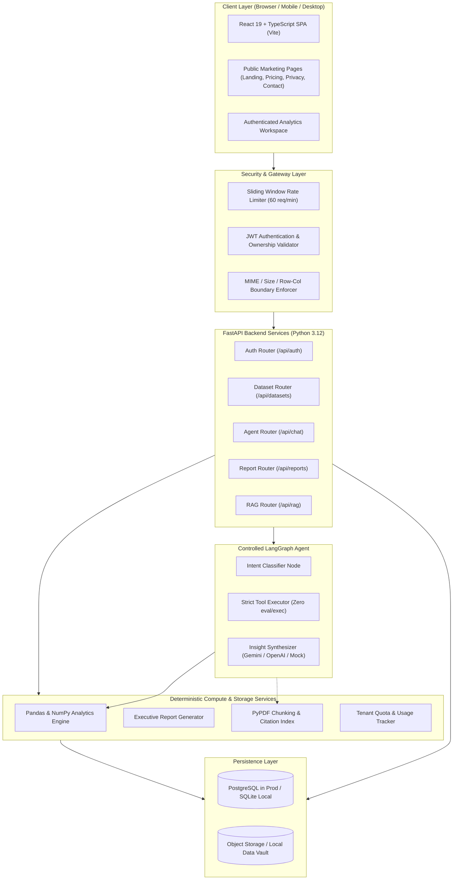

# DataPilot AI — System Architecture Specification

## 1. System Overview

DataPilot AI is an enterprise-grade AI Data Analyst SaaS application designed to deliver trustworthy, deterministic spreadsheet analytics. The architecture decouples **unstructured natural language interpretation** (delegated to LLMs via LangGraph) from **quantitative computation** (delegated exclusively to Python Pandas and NumPy engines).

---

## 2. Component Architecture

### 2.1 Frontend Architecture (`frontend/`)
* **Framework**: React 19 + TypeScript bundled with Vite.
* **Component Architecture**:
  * **Public Marketing Tier**:
    * `LandingPage`: Hero with CTA, dynamic features showcase, live interactive demo sandbox, workflow steps.
    * `PricingPage`: Tiered matrix (`Free`, `Starter`, `Pro`, `Enterprise`) with feature comparison and FAQ.
    * `PrivacyPage`: Data handling statement, non-training commitment, encryption standards.
    * `ContactPage`: Support and business inquiry submission.
    * `AuthModal`: User login and registration modal with client-side validation.
  * **Authenticated Workspace Tier**:
    * `Navbar`: Brand, active tenant status, quick-load sample switcher, user profile menu.
    * `UploadSection`: Drag & drop CSV/XLSX uploader with sheet selector.
    * `KPIOverview`: Dynamic health metrics (total rows, columns breakdown, missing values, duplicates).
    * `DataPreviewTable`: Paginated data table with semantic type badges, search filter, and CSV export.
    * `CleaningStudio`: Non-destructive deduplication and missing value imputation studio.
    * `ChatInterface`: Conversational workspace with tool execution transparency badges, insight highlights, and embedded interactive Recharts.
    * `InteractiveChart`: High-performance charts (Bar, Line, Pie) with a toggle between graphical and tabular data views.
* **Styling**: Modern dark studio design system with CSS custom properties, glassmorphism (`backdrop-filter: blur(16px)`), and responsive layouts.

### 2.2 Backend Architecture (`backend/`)
* **Framework**: FastAPI (async/await) running on Uvicorn.
* **Modules**:
  * `backend/core/`: Configuration settings (`config.py`) via Pydantic Settings, structured logging (`logging.py`).
  * `backend/db/`: SQLAlchemy models (`models.py`) and connection lifecycle (`database.py`) with automatic SQLite / PostgreSQL detection.
  * `backend/services/`:
    * `data_service.py`: Reusable Pandas analytics engine, Excel multi-sheet parser, outlier detector (IQR & Z-score), profiling, safe cleaning, aggregations, and time-series trends.
    * `rate_limiter.py`: Sliding window in-memory rate limiter per client IP / user ID.
    * `report_service.py`: Generates executive analytical reports in Markdown and HTML with download capability.
    * `quota_service.py`: Tracks and enforces per-tier quotas.
  * `backend/agent/`:
    * `tools.py`: Allowlisted deterministic tools with typed Pydantic parameter schemas.
    * `workflow.py`: LangGraph state machine with Intent Router, Tool Executor, and Insight Synthesizer.
  * `backend/rag/`:
    * `document_service.py`: PDF parser (`pypdf`), chunker, and citation retrieval engine.
  * `backend/api/`:
    * `routes.py`: Endpoints for upload, sample preloading, dataset inspection, cleaning, direct analytics, chat, history, and RAG.
    * `auth_routes.py`: User registration, login, and profile retrieval.

---

## 3. Security & Data Isolation Model

1. **Zero Code Execution**:
   * The LLM **never** generates executable code that is passed to `exec()` or `eval()`.
   * Queries map to pre-compiled, parameter-checked Python analytical functions.
2. **Tenant Isolation**:
   * Every dataset and conversation is keyed by `user_id`.
   * Backend authorization checks verify ownership on every read, clean, query, and delete operation.
3. **Immutable Source Retention**:
   * Original uploaded files are preserved in read-only form.
   * Cleaning actions produce separate transformed datasets and record an audit log entry.
4. **Credential Safety**:
   * API keys and secrets exist only in environment variables.
   * Passwords hashed using standard cryptographic algorithms (`bcrypt`).
   * No sensitive dataset rows or auth tokens written to server logs.
